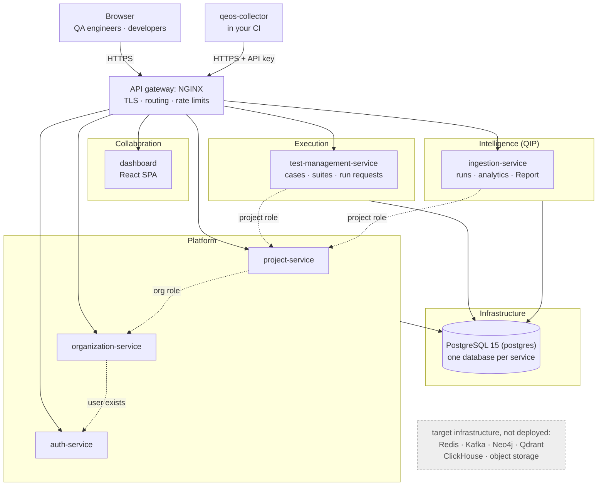
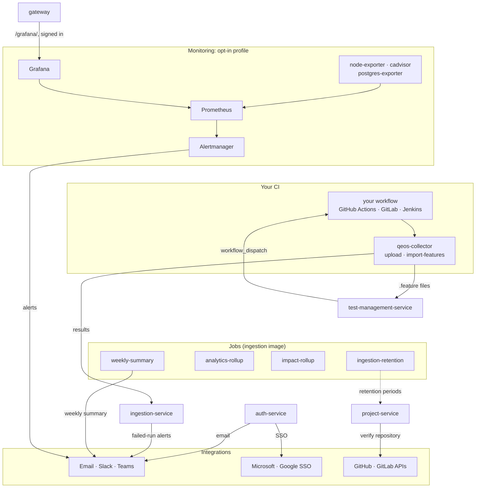

# QEOS — Quality Engineering OS

**One place for a team's test results, test cases and test runs.**

Your CI uploads its test reports to QEOS, and QEOS turns them into answers:

- what failed, and why;
- what got worse since last week;
- which tests are flaky;
- which cases have never run.

The test-case catalogue stays in sync with your Gherkin features. You can start a run in your own GitHub
Actions with one click.

QEOS never runs your test code itself and never needs access to your servers. It reads the reports your
pipeline already produces, and it starts runs only through workflows you own.

---

## Contents

- [Why QEOS](#why-qeos)
- [Features](#features)
- [Architecture](#architecture)
- [Quick start](#quick-start)
- [Send your first results](#send-your-first-results)
- [Optional: monitoring](#optional-monitoring)
- [Production](#production)
- [Development and tests](#development-and-tests)
- [Security](#security)
- [Documentation map](#documentation-map)
- [Project status](#project-status)
- [License](#license)

---

## Why QEOS

| Without QEOS | With QEOS |
|---|---|
| Test results live in CI logs and expire with the build | Every run is stored, searchable and compared with the previous ones |
| "Is this test flaky or broken?" is a guess | Same-commit flips are detected and flaky tests can be quarantined |
| Test cases sit in a spreadsheet that drifts from the code | Cases are imported and kept in sync with the `.feature` files on your default branch |
| Re-running a subset means editing CI config | Select scenarios, press **Play**, and QEOS dispatches your GitHub Actions workflow |
| Weekly quality reporting is manual | A filterable, printable report and a weekly summary to Slack, Teams or email |

---

## Features

### Results and analytics
- **Any CI, many formats.** The [`qeos-collector`](collector/README.md) uploads results with a per-project API key. It reads:
  - JUnit XML, including Surefire rerun attempts;
  - Cucumber and Playwright JSON;
  - TRX, NUnit, xUnit and TestNG.

  Ready-made integrations: a [GitHub Action](collector-action/action.yml), a [Jenkins library](collector-jenkins/README.md), and GitLab and Azure DevOps templates.
- **Collect manual CI runs or not:** a per-project switch in Settings › Collection; runs a person started by hand in CI can be left out (needs collector 0.5.0).
- **Runs and history:** every run with its commit, branch, pull request, author and changed files, plus the history of each test.
- **Trends** by day, week or month, per branch, and run-to-run comparison.
- **Flaky tests:** same-commit detection over up to 90 days, backed by daily rollups, with quarantine.
- **Failure causes:** new, recurring and resolved failures, grouped by cause.
- **Test impact:** for each change, a **Likely affected tests** card on the run page lists the tests it is likely to affect, from which tests newly failed after earlier changes to the same files (no coverage instrumentation, no AI). Each suggestion shows its evidence, and the card says which new failures it caught and missed once the results are in. Suggestions are stored at upload, before the results, so the accuracy is honest.
- **Customisable Overview:** each person arranges their own Overview per project: move, resize, remove and add widgets and change their settings, then save. Owners and admins also set the project's default layout, which everyone without a personal layout sees. Start from a template (QA lead, Developer, Flaky hunt) or pick from fifteen widgets: the built-in four, plus Pass-rate trend, Failure causes, Regressions and flips, Slowest tests, Coverage, Recent runs, Branch health, Test cases, My suites, My recent failures and Impact accuracy (the test impact catch rate).

### Report
- **One report per period:**
  - summary with deltas;
  - regressions and instability (flips);
  - results by feature, folder, label or suite;
  - coverage: cases never run, and tests without a case;
  - duration;
  - **Test impact:** how often the likely affected tests contained a run's new failures, with the average suggestion size beside it, live and replayed history apart, and the misses.
- Printable, with CSV export.

### Test management
- A **case catalogue** with suites, priorities, statuses and links to the automated tests that cover each case.
- A **Feature view** grouped by `.feature` file.
- **Failed step:** a scenario's latest failure, from any branch, shows its failing step in red on the scenario page and the feature page's cards. Hover or keyboard focus shows the error, branch, environment, time and **Open run**.
- **Gherkin import:** from the browser, or synced from the repository's default branch.
- **Run from QEOS:** run a selection, a case or a suite in your GitHub Actions workflow, with a duration estimate before, during and after the run.
- **Run likely affected:** on the Test cases page, select the cases linked to the tests a branch's latest change is likely to affect, then run them as usual.

### Accounts and access
- **Sign-in:**
  - email and password, with verification, reset and change;
  - TOTP two-factor authentication with recovery codes;
  - Google and Microsoft (Entra ID) single sign-on, with a tenant allowlist.
- **Organisations** with owner, admin, member and viewer roles, and invitations.
- **Projects** with repositories and per-project settings.

### Operations
- **Notifications:** Slack, Microsoft Teams, webhook and email, for failed runs and a weekly summary.
- **Data protection:**
  - masking of secrets and personal data before results are stored;
  - per-project retention;
  - legal hold;
  - full NDJSON export.
- **Metrics:** `/metrics` in Prometheus format on every service, plus heartbeats for the background jobs.
- **Optional monitoring stack:**
  - Prometheus, Alertmanager and Grafana with five dashboards;
  - alerts to email, Slack or Teams;
  - superusers open it from the app ([below](#optional-monitoring)).

---

## Architecture

Two diagrams. The first follows the blueprint's container view
([§22, Level 2](ARCHITECTURE_BLUEPRINT_V1_0.md#22-c4-architecture-model)): the same domains, filled with
what runs today. Dotted arrows are the role checks one service asks another for; the grey box is the
blueprint's target infrastructure, none of it deployed.



The second shows what runs beside the services and what they reach outside QEOS: the jobs, the
run loop with your CI, the Integrations domain and the opt-in monitoring profile.



The run loop: test-management-service dispatches your workflow, which runs the tests and sends the
results back through the collector to ingestion-service. A second workflow syncs the `.feature` files
into test-management-service ([SETUP §4.2.3](docs/SETUP.md)).

| Component | Path | Blueprint domain | Responsibility |
|---|---|---|---|
| Gateway | [`gateway/`](gateway/README.md) | API gateway | NGINX: TLS, routing, per-IP rate limits, JSON errors; proxies to the dashboard and the services |
| Dashboard | [`dashboard/`](dashboard/) | Collaboration | React 19 + TypeScript single-page app, served by its own NGINX container |
| auth-service | [`platforms/auth-service/auth-service/`](platforms/auth-service/auth-service/) | Platform | Users, sign-in, tokens, SSO, MFA |
| organization-service | [`platforms/organization-service/`](platforms/organization-service/) | Platform | Organisations, members, invitations |
| project-service | [`platforms/project-service/`](platforms/project-service/) | Platform | Projects, repositories, settings, retention |
| test-management-service | [`platforms/test-management-service/`](platforms/test-management-service/README.md) | Execution | Test cases, suites, Gherkin import and sync, run requests |
| ingestion-service | [`platforms/ingestion-service/`](platforms/ingestion-service/README.md) | Intelligence (QIP), Collaboration | Uploads, runs, analytics, the Report, notification channels |
| Jobs | [`platforms/ingestion-service/src/ingestion/jobs/`](platforms/ingestion-service/src/ingestion/jobs/) | Intelligence (QIP) | `ingestion-retention`, `analytics-rollup` (flaky rollups), `impact-rollup` (test impact statistics) and `weekly-summary`: containers of the ingestion image |
| Collector | [`collector/`](collector/README.md) | Integrations | The CI-side uploader and feature sync (`pip`, single-file `.pyz` or container image) |
| PostgreSQL | [`scripts/postgres-init.sh`](scripts/postgres-init.sh) | Infrastructure | `postgres`: PostgreSQL 15, one database per service, created on every start if missing |
| Shared library | [`shared/qeos_shared/`](shared/) | Shared kernel | Settings, database session, mail and metrics helpers |
| Monitoring | [`monitoring/`](monitoring/) | Observability (§11) | Prometheus, Alertmanager, Grafana and the `node-exporter`, `cadvisor` and `postgres-exporter` exporters (opt-in profile) |
| Production package | [`deploy/`](deploy/README.md) | Deployment (§9, L0) | Single-VM deployment: the same services behind `edge`, a Caddy TLS proxy |

Blueprint domains not started: Automation, Marketplace, AI runtime. Administration lives in the Platform services for now.

**Stack:** Python 3.11 with FastAPI, SQLAlchemy and Alembic, PostgreSQL 15, React 19, NGINX and Docker Compose.

**Kept in step:** CI runs [`scripts/check_architecture_docs.py`](scripts/check_architecture_docs.py), which fails when the diagram,
this table or the blueprint's status banner names a service the compose files don't run, or misses one they do. It also
checks each service's API prefixes against the gateway's routing and the [gateway's Routes table](gateway/README.md#routes).

**Design principles:**
- The services never call each other to build a page. The dashboard composes the data ([ADR-022](docs/architecture/adr/INDEX.md)).
- Ingestion is push-based.
- Every architectural decision is recorded as an [ADR](docs/architecture/adr/INDEX.md).
- The target architecture, and what is built versus planned, is in [`ARCHITECTURE_BLUEPRINT_V1_0.md`](ARCHITECTURE_BLUEPRINT_V1_0.md).

---

## Quick start

**Prerequisites:**
- Docker with Compose 2.24 or newer, with at least 4 GB of RAM for Docker;
- Git;
- on Windows, Git Bash for the helper scripts.

**1. Clone and configure**

```bash
git clone https://github.com/carneiru/QA-Vision-Platform.git
cd QA-Vision-Platform
cp .env.example .env
```

Edit `.env` and set `SECRET_KEY` and `INTERNAL_API_PASSWORD` to long random values, for example from
`openssl rand -hex 32`. Every other variable has a working local default. All of them are explained in
[`docs/SETUP.md` §2.3](docs/SETUP.md#23-every-variable-in-env).

**2. Start the platform**

```bash
docker compose up -d --build --wait gateway
curl -k https://localhost:8443/health        # {"status":"healthy"}
```

Naming only `gateway` starts everything it depends on: PostgreSQL, the database migrations, the five
services, the dashboard and the background jobs. The first build takes a few minutes. Databases are
created and migrated on every `up`.

**3. Open the app**

Go to **https://localhost:8443** and accept the self-signed certificate. To trust it permanently,
see [SETUP §2.7](docs/SETUP.md#27-trust-the-local-https-certificate). Then:

1. Create an account.
2. Verify your email. Without SMTP configured, the verification link is written to the auth-service log:
   `docker compose logs auth-service`.
3. Create an organisation and a project.

**Everyday commands**

| Task | Command |
|---|---|
| Status | `docker compose ps -a` |
| Logs of one service | `docker compose logs -f ingestion-service` |
| Rebuild after `git pull` | `docker compose up -d --build --wait gateway` |
| Stop (data kept) | `docker compose down` |
| Wipe all data | `docker compose down --volumes` (irreversible) |

---

## Send your first results

1. In the project, open **Settings** and create an **API key**.
2. Run your tests, then upload the reports from the same folder:

```bash
pip install "qeos-collector @ git+https://github.com/carneiru/QA-Vision-Platform@collector-v0.6.0#subdirectory=collector"
export QEOS_URL=https://localhost:8443 QEOS_API_KEY=<your key>
qeos-collector upload "reports/**/*.xml"
```

3. Open the project: the run, its tests and the trends appear right away.

**Settings → Wire up your CI** gives a ready-to-paste snippet for GitHub Actions, GitLab CI, Azure Pipelines,
Jenkins and the CLI. [SETUP §5](docs/SETUP.md#5-wiring-a-real-test-repository-end-to-end) walks through
a real repository end to end:
- uploads from CI;
- Gherkin sync;
- Run from QEOS.

---

## Optional: monitoring

The `monitoring` compose profile adds:
- Prometheus and Alertmanager;
- Grafana with five dashboards: QEOS overview, service detail, jobs and uploads, PostgreSQL, and host and containers;
- node-exporter, cAdvisor and postgres-exporter.

It is off by default. When it is off, the platform runs exactly as without it.

```bash
# in .env
COMPOSE_PROFILES=monitoring
MONITORING_ENABLED=true
GRAFANA_ADMIN_PASSWORD=<long random value>
MONITORING_DB_PASSWORD=<long random value>
```

Superusers then open Grafana from the account menu's **Monitoring** item, at `https://localhost:8443/grafana/`.
The gateway checks the QEOS session on every request, so there is no second password to manage.
Alert channels, resources and break-glass access are in [SETUP §7.4](docs/SETUP.md#74-monitoring-optional)
and [`deploy/README.md`](deploy/README.md). The design is in [ADR-027](docs/architecture/adr/INDEX.md).

---

## Production

[`deploy/`](deploy/README.md) packages the same stack for a single VM:
- a Caddy TLS edge with Let's Encrypt, as the only published service;
- secrets generated by `init-env.sh`;
- restart policies;
- daily backups with a verified restore.

The design is in ADR-019.

---

## Development and tests

| Scope | Command |
|---|---|
| One Python service | `cd platforms/<service> && SECRET_KEY=test .venv/Scripts/python -m pytest -q` (auth-service lives in `platforms/auth-service/auth-service`) |
| Shared library | `cd shared && SECRET_KEY=test ../platforms/organization-service/.venv/Scripts/python -m pytest tests -q` |
| Dashboard | `cd dashboard && npm run lint && npm run typecheck && npx vitest run && npm run build` |
| Monitoring configuration | `bash monitoring/check.sh` (promtool rule tests, amtool, dashboard lint) |
| Whole stack | `bash scripts/smoke_gateway.sh` against a running local stack |
| Architecture docs | `python scripts/check_architecture_docs.py` (README diagram and table, blueprint banner, gateway routes) |

**Continuous integration** ([`.github/workflows/ci.yml`](.github/workflows/ci.yml)) runs on every push:
- every service suite;
- the dashboard checks;
- container smoke tests;
- the full-stack gateway smoke, twice: without and with the monitoring profile;
- the architecture docs check.

**Before pushing:** `git config core.hooksPath .githooks` once per clone runs the architecture docs check
on every `git push` ([`.githooks/pre-push`](.githooks/pre-push), under a second). The suites stay with you and CI.

**Conventions:**
- Work lands directly on `master` with every suite green.
- Behaviour changes are test-driven.
- Every commit that changes behaviour updates the documentation it affects.

---

## Security

- **Passwords and tokens:**
  - passwords are hashed with bcrypt;
  - JWT access tokens are short-lived;
  - refresh tokens rotate, have replay detection and live in an httpOnly cookie.
- **Sign-in protection:**
  - TOTP MFA;
  - SSO ID tokens are verified against the providers' keys;
  - stricter rate limits on the sign-in endpoints.
- **Uploads:**
  - per-project API keys;
  - masking of secrets and personal data before storage.
- **Exposure:** `/metrics` and the internal endpoints are never routed publicly.

Known limitation: an access token stays valid until it expires (minutes).

The threat model and operational guidance are in [`SECURITY.md`](SECURITY.md).

---

## Documentation map

| Document | What it holds |
|---|---|
| [`docs/SETUP.md`](docs/SETUP.md) | Complete setup and operations guide: every variable, accounts, each feature, troubleshooting |
| [`PRODUCT.md`](PRODUCT.md) | Product rules and behaviour |
| [`ARCHITECTURE_BLUEPRINT_V1_0.md`](ARCHITECTURE_BLUEPRINT_V1_0.md) | Target architecture; its banner shows what is built and each adoption trigger |
| [`TECHNICAL_SPECIFICATION.md`](TECHNICAL_SPECIFICATION.md) | Current-state technical specification |
| [`IMPLEMENTATION_PLAN.md`](IMPLEMENTATION_PLAN.md) · [`TODO.md`](TODO.md) · [`NEXT_STEPS.md`](NEXT_STEPS.md) | Forward plan, item-level record, next steps |
| [`DESIGN.md`](DESIGN.md) | Dashboard UI rules |
| [`SECURITY.md`](SECURITY.md) | Security model and operations |
| [`docs/architecture/adr/`](docs/architecture/adr/INDEX.md) | Architecture decision records |

---

## Project status

**Built and running:**
- the platform foundation: accounts, organisations, projects and the gateway;
- ingestion with the collector and its CI integrations;
- analytics, the report, notifications and the customisable Overview;
- test impact analysis (ADR-029): suggestions stored at upload with their outcome, accuracy in the Report and on the Overview, and Run likely affected;
- test management with Gherkin sync and Run from QEOS;
- the optional monitoring stack;
- the single-VM production package.

**Next:** release B (a collector command that runs the suggested tests first), then tuning test impact on real data. The full plan is in [`IMPLEMENTATION_PLAN.md`](IMPLEMENTATION_PLAN.md).

The directories `execution/`, `automation/`, `marketplace/`, `collaboration/`, `intelligence/` and
`platforms/qip-service` are **unwired prototypes**. They are not in Compose, CI or the gateway, and they
are not shipped functionality.

---

## License

[MIT](LICENSE) © 2026 Pedro Carneiro.
